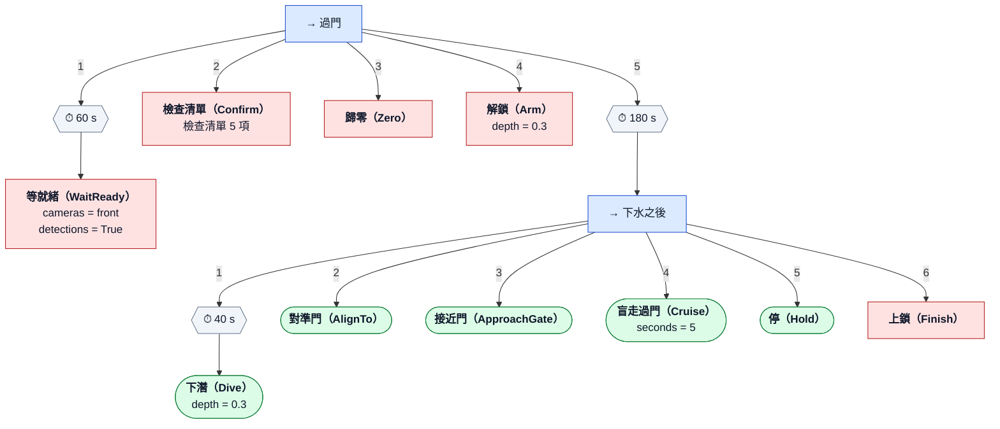

# gate_pass

<!-- 由 render_tree 從 gate_pass.yaml 產生，不要手改 -->

歸零（浮在水面）→ 解鎖 → 下潛 → 原地轉向對準門 → 鎖航向前進、左右只用 sway 修 → 門夠近（或近距離跟丟）→ 盲走 pass_s 秒 → 停 → 上鎖。各步的參數跟 mission/gate_pass.py 相同。

| 變數（-p 覆寫） | 預設 |
|---|---|
| `depth` | `0.3` |
| `surge` | `0.2` |
| `pass_s` | `5` |
| `labels` | `gate/qualification_gate` |
| `min_score` | `0.5` |
| `ready_timeout` | `60` |

圖例：→ Sequence（依序，一個失敗就失敗）、? Selector（依序嘗試，一個成功就成功）、
⇉ Parallel、⏱ 逾時、↻ 重試；綠色圓角 = 執行器（tasks/，經 TaskRunner 控制推進器）、
紅色 = 任務層節點（就緒檢查、確認、歸零、解鎖、上鎖）、菱形 = 條件。
邊上的數字是執行順序。樹結束（成功或失敗）時一律 MANUAL、全 0、DISARM。
