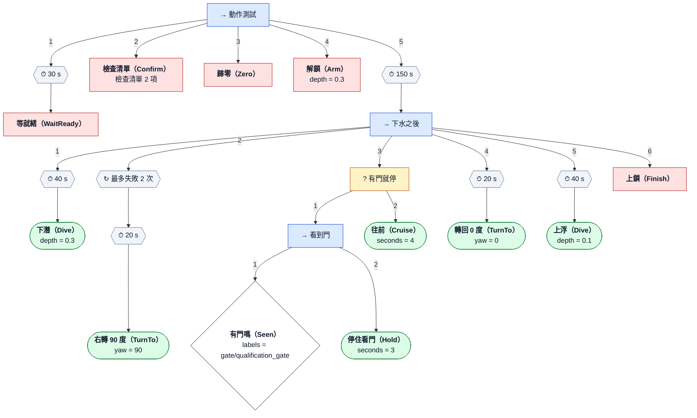

# smoke_test

<!-- 由 render_tree 從 smoke_test.yaml 產生，不要手改 -->

下潛 → 右轉 90° → 往前 → 轉回 0° → 浮上 → 上鎖。中間用 Selector 示範「看到門就停、 沒看到就繼續」：模擬的泳池沒有門，所以會走「沒看到」那一支。

| 變數（-p 覆寫） | 預設 |
|---|---|
| `depth` | `0.3` |
| `surge` | `0.2` |

圖例：→ Sequence（依序，一個失敗就失敗）、? Selector（依序嘗試，一個成功就成功）、
⇉ Parallel、⏱ 逾時、↻ 重試；綠色圓角 = 執行器（tasks/，經 TaskRunner 控制推進器）、
紅色 = 任務層節點（就緒檢查、確認、歸零、解鎖、上鎖）、菱形 = 條件。
邊上的數字是執行順序。樹結束（成功或失敗）時一律 MANUAL、全 0、DISARM。
